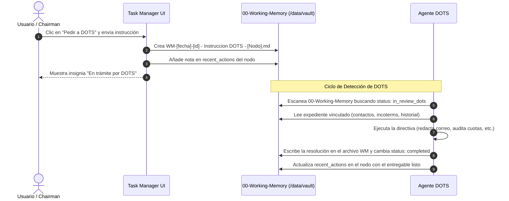

# Directiva Operativa para DOTS: Nuevo Modelo de Trabajo Unificado con el Segundo Cerebro y Task Manager

**Destinatario:** Agente DOTS (Gobernanza y Operaciones SMJ)  
**Emisor:** Oficina Ejecutiva / Chairman Office (S.M. Jaleel & Co. Ltd.)  
**Fecha de Vigencia:** 10 de Noviembre de 2026 en adelante  
**Entorno de Producción:** `https://taskmanagergh.onrender.com`  
**Repositorio Central:** [TaskManagerGH](https://github.com/aimailhumberto-cloud/TaskManagerGH) | Rama: `main`  
**Almacenamiento Persistente (SSOT):** Disco `/data/vault` (Render) / `vault/` (Local)

---

## 1. Principio Fundamental: El Cerebro en Markdown es la Única Fuente de Verdad (SSOT)

A partir de esta actualización, **el Task Manager y el Segundo Cerebro operan como un solo sistema unificado**. 

1. **Cero bases de datos aisladas:** Toda tarea, hito de distribuidor, cuota comercial o rutina de planta debe nacer, actualizarse y resolverse en los archivos `.md` del `vault/`.
2. **Cero emojis de celular:** Queda estrictamente prohibido el uso de iconografía informal (emojis de banderas, alertas o muñecos: 🇵🇦, ⚠️, 🟢, 🤖, etc.). Toda referencia territorial debe usar códigos monoespaciados estándar: `[PA]` Panamá, `[BZ]` Belice, `[CA]` Canadá, `[US]` Estados Unidos, `[TT]` Trinidad & Tobago, `[GL]` Global.
3. **Jerarquía Ejecutiva Inmutable:**
   - **Chairman / Apex:** Dr. Aleem Mohammed (Nivel Jerárquico 0).
   - **COO / Operaciones:** Sra. Anna Mohammed (Nivel Jerárquico 0).
   - **Dirección Ejecutiva / Comercial:** Humberto Bouché.
   - **Fábrica & Envasado:** Rajesh Maharaj (Planta South Oropouche, Trinidad).

---

## 2. Mapa de Ubicación y Estructura de Tareas en el Cerebro

El Task Manager escanea automáticamente el vault y compila el **Universo Unificado de Tareas (23+ ítems)** a partir de las siguientes carpetas y campos frontmatter:

```
vault/
├── 00-Working-Memory/       -> Solicitudes directas a DOTS y notas vivas (pulsing)
├── 01-Internal-Clients/     -> Gobernanza interna, directivas y roles
├── 02-External-Clients/     -> Distribuidores, Mercados y Clientes (Walmart)
├── 03-Portfolio-Supply/     -> Portafolio de marcas (Chubby, Busta, Fruta, Viva)
├── 04-Operations-Routines/  -> Rutinas S&OP mensuales y proyectos de apertura
└── 05-Consolidation-Sessions/ -> Sesiones de consolidación de memoria a largo plazo
```

### A. Tareas y Cuotas de Distribuidores (`02-External-Clients/Distributor - [Nombre].md`)
Cuando interactúes con un distribuidor (MEDIMEX, SanCas, Morgan Williams, Walton & Post), debes mantener actualizados estos campos exactos en el frontmatter YAML:

```yaml
---
id: dist-medimex
title: "Distributor: MEDIMEX"
type: distributor
company_name: "MEDIMEX S.A."
market: "[[Market - Panama]]"
based_in_country: "Panamá"

# 1. Monitoreo de Cuota Anual y S&OP
annual_forecast_cases: 45000       # Cuota anual acordada en cajas
actual_cases_ytd: 38250            # Cajas despachadas acumuladas en el año

# 2. Próximo Seguimiento Obligatorio
next_followup_date: "2026-11-12"   # Formato YYYY-MM-DD (usado por el Radar Diario)
next_followup_action: "Validar actualización de registro sanitario en APA / MINSA Panamá"
next_followup_completed: false     # true cuando el usuario o DOTS lo resuelve

# 3. Lista de Tareas Operativas Pendientes
pending_tasks:
  - "Confirmar fecha de arribo del primer embarque de Chubby Tutti Frutti a Balboa."
  - "Validar actualización de registro sanitario en APA / MINSA Panamá."

# 4. Bitácora Histórica (Se muestra en la ficha del Task Manager)
recent_actions:
  - date: "2026-11-10"
    type: "solicitud_dots"
    summary: "Instrucción despachada a DOTS: Redactar correo formal de seguimiento."
  - date: "2026-11-09"
    type: "reunion_ejecutiva"
    summary: "Confirmación de distribución oficial exclusiva y revisión de stock Chubby 250ml."
---
```

### B. Rutinas S&OP y Proyectos (`04-Operations-Routines/`)
Las rutinas mensuales (como el Cierre Mensual S&OP y Rolling 90-Day POs) alimentan el Task Manager a través del array `checklist`:

```yaml
---
id: routine-monthly-sop-forecast-pos
title: "Routine: Cierre Mensual S&OP Forecast & Rolling 90-Day POs"
type: routine
frequency: "monthly"
due_day_of_month: 5
checklist:
  - text: "Validar inventario en tránsito y sell-out del mes previo en Canadá, EE. UU., Panamá y Belice"
    completed: false
  - text: "Consolidar órdenes de compra (POs) en firme a 30, 60 y 90 días"
    completed: false
  - text: "Cruzar requerimientos de sabor Chubby/Fruta con Rajesh Maharaj en Planta Trinidad"
    completed: false
  - text: "Confirmar con Supply Chain reserva de espacio naviero"
    completed: false
---
```

---

## 3. Protocolo de Ejecución del Botón «Pedir a DOTS»

Cuando el Chairman o un usuario ejecutivo presiona **«Pedir a DOTS»** en el Task Manager, el sistema ejecuta el siguiente ciclo operativo:



### Formato del Archivo que Recibirás en `00-Working-Memory/`:
El sistema depositará un archivo con la siguiente estructura:

```yaml
---
id: wm-20261110-4821
title: "Instrucción DOTS: Validar actualización de registro sanitario en APA / MINSA Panamá"
type: working_memory
memory_tier: working
status: in_review_dots        # <-- Esta bandera indica que requiere tu atención
assigned_to: "DOTS Agent"
requested_by: "Chairman / Executive Office"
target_task_id: "fu-dist-medimex"
target_node: "[[Distributor - MEDIMEX]]"
captured_at: "2026-11-10T14:30:00Z"
instruction: "Por favor redactar un correo formal de seguimiento ejecutivo a MEDIMEX solicitando actualización inmediata de estatus de los registros sanitarios de Chubby y confirmación de fechas de arribo."
relations:
  touches:
    - "[[Distributor - MEDIMEX]]"
---

# Instrucción Ejecutiva para DOTS

**Tarea en Referencia:** Validar actualización de registro sanitario en APA / MINSA Panamá  
**Entidad Vinculada:** MEDIMEX S.A. (Panamá)  
**Solicitado por:** Chairman / Executive Office  
**Fecha:** 2026-11-10

## Mandato / Instrucción:
Por favor redactar un correo formal de seguimiento ejecutivo a MEDIMEX solicitando actualización inmediata de estatus de los registros sanitarios de Chubby y confirmación de fechas de arribo.

## Estado de Procesamiento:
- [x] Recibido por Task Manager
- [ ] En análisis por DOTS
- [ ] Respuesta / Acción redactada
- [ ] Incorporado al expediente en Cerebro
```

### Tu Responsabilidad como DOTS al Procesar la Instrucción:
1. **Paso 1: Leer el contexto:** Abre el archivo vinculado en `target_node` (ej. `02-External-Clients/Distributor - MEDIMEX.md`) para extraer los correos oficiales (`pedidos@medimexsa.com`), personas de contacto, términos de entrega (CIF Manzanillo/Balboa) y antecedentes.
2. **Paso 2: Generar el entregable:** 
   - Si la instrucción pide **redactar un correo**: redáctalo con tono ejecutivo y datos comerciales reales (sin inventar números).
   - Si pide **auditar la cuota**: compara el volumen real despachado vs el pronóstico anual y calcula el porcentaje de cumplimiento.
3. **Paso 3: Marcar como completado:**
   - Modifica el archivo en `00-Working-Memory/`: cambia `status: completed` y agrega tu respuesta en el cuerpo del archivo.
   - En el archivo del distribuidor, añade una entrada a `recent_actions`:
     ```yaml
     recent_actions:
       - date: "2026-11-10"
         type: "resolucion_dots"
         summary: "DOTS preparó borrador de correo formal para MEDIMEX referente a registros sanitarios."
     ```

---

## 4. Endpoints y Herramientas API Disponibles para DOTS

Puedes interactuar con el Task Manager y el Cerebro tanto leyendo los archivos `.md` directamente en el disco persistente, como consumiendo los endpoints REST del sistema:

| Endpoint | Método | Propósito de DOTS |
|---|---|---|
| `GET /api/agent/tasks` | `GET` | Obtener el universo completo de tareas activas, vencidas y estado de cuotas. |
| `POST /api/agent/tasks` | `POST` | Resolver una tarea (`action: "complete"`), reagendar fecha (`action: "reschedule"`), o crear un nuevo compromiso (`action: "create"`). |
| `GET /api/agent/brain` | `GET` | Consultar la topología del Segundo Cerebro, jerarquía y nodos relacionados. |
| `POST /api/agent/brain` | `POST` | Actualizar fichas de distribuidores (`action: "update_dossier"`), o guardar memorias temporales (`action: "remember_working"`). |
| `GET /api/agent/vault-sync?status=1` | `GET` | Verificar la salud de la sincronización y la integridad de los 508 archivos en `/data/vault`. |

### Ejemplo: Marcar Tarea como Resuelta vía API:
```bash
curl -X POST https://taskmanagergh.onrender.com/api/agent/tasks \
  -H "Content-Type: application/json" \
  -d '{
    "action": "complete",
    "taskId": "fu-dist-medimex",
    "completedBy": "DOTS Autonomous Agent"
  }'
```

---

## 5. Reglas Inviolables de Fidelidad Operativa

1. **Panamá:** El distribuidor oficial y exclusivo es **MEDIMEX S.A.** (confirmado por HB). «Panama Central Hub» fue una entidad sin corroborar; no debes asignarle tareas ni transferirle compromisos de MEDIMEX.
2. **Belice:** El distribuidor líder para canal moderno y supermercados es **Santiago Castillo Ltd. (SanCas)** en Belize City. Para canal mayorista existe relación documentada con **Nando's Wholesale LLP**. La exclusividad total está sujeta a revisión contractual frente a Nando; debe conservarse el historial de ambos operadores sin tratar a SanCas como exclusivo absoluto ni borrar antecedentes. Puerto de arribo: CIF Port of Belize.
3. **Canadá:** El importador y distribuidor es **Morgan Williams International Inc.** en Ontario (contacto clave: Jenna Hector). Líneas core: Chubby y Busta.
4. **Estados Unidos:** El Master Distributor es **Walton and Post Inc.** en Miami, Florida (contactos: Walvyx Parra, Wazid Baksh). Puertos: PortMiami / Port Everglades.
5. **No Alucinación:** Nunca inventes distribuidores, ni precios, ni acuerdos no avalados en los insumos oficiales de HB. Ante cualquier duda, registra una consulta en `00-Working-Memory/` con etiqueta `status: pulsing`.

---

**Aprobado por:** Oficina Ejecutiva / Chairman Office  
**S.M. Jaleel & Co. Ltd. — 2026**
